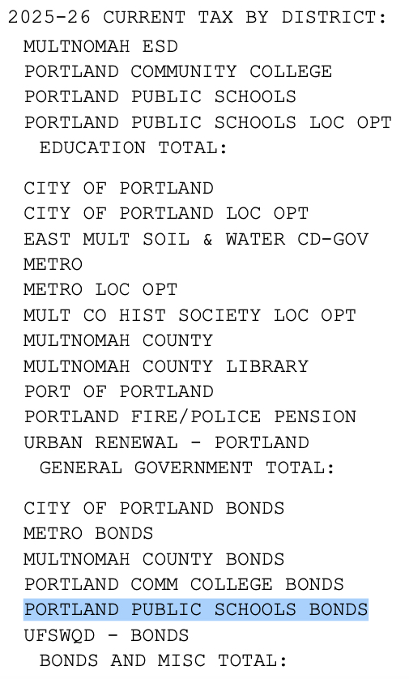
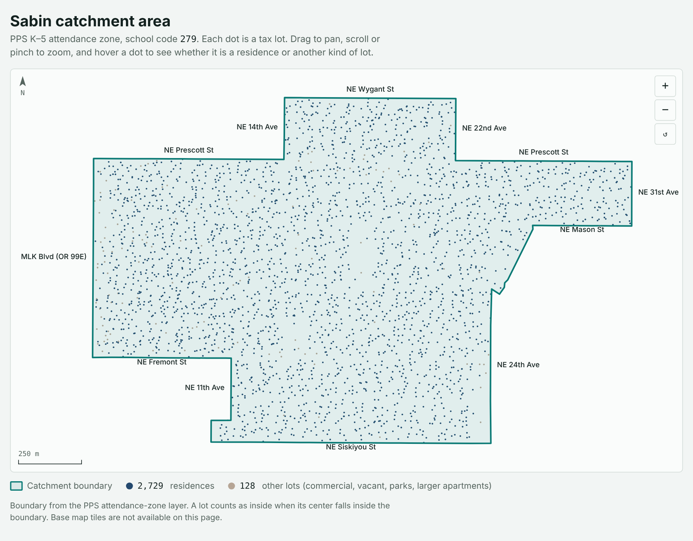
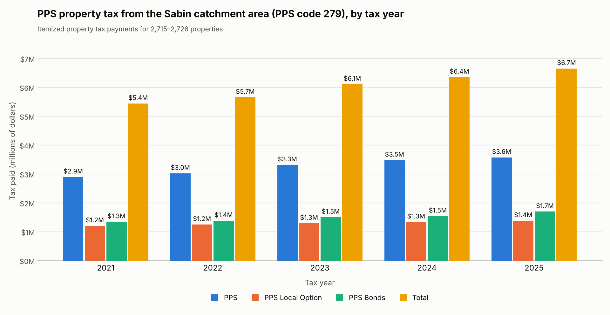

> **Claude:** to re-create this analysis from scratch, follow the step-by-step instructions in [CLAUDE.md](CLAUDE.md).

# PPS property tax revenue in the Sabin catchment area, 2021-2025

How much property tax do the homes in the Portland Public Schools Sabin Elementary (K-5) catchment area pay to PPS, and how has it changed?
This repo reports the answer for tax years 2021 through 2025 using the Multnomah County tax statement for every residence in the catchment area.
The scripts and the address-level records live in a separate private repo (`sabin_tax_records`); this one holds the findings and the aggregate data.

**In short:** the 2,729 residences in the area were billed **$6.65 million** for PPS in tax year 2025, 
under the combined property tax line items `PORTLAND PUBLIC SCHOOLS`, `PORTLAND PUBLIC SCHOOLS LOC OPT` and `PORTLAND PUBLIC SCHOOLS BONDS`.

Figure ITEMIZED_PROPERTY_TAX_STATEMENT_EXAMPLE: Itemized Property Tax Statement Example

These line items have increased **5.2% annualized** between 2021-2025. 
For comparison, the main national inflation measures have increased 3.5% to 4.4% annualized over the same span.

## 1. Sabin Catchment Area

The boundary is the PPS Sabin K-5 attendance zone (PPS school code 279), taken from the PPS attendance-zone map layer.
An interactive version of this map is in [`map/sabin_catchment_map.html`](map/sabin_catchment_map.html). Open the file in a browser, or, if GitHub Pages is enabled for this repo, at `https://astangepdx.github.io/sabin_tax_report/map/sabin_catchment_map.html`.
The boundary as GeoJSON is [`data/boundary_sabin_k5.geojson`](data/boundary_sabin_k5.geojson). The map shows lots only as dots and carries no street addresses.

## 2. Properties

A tax lot is counted as inside the area when the lot's center point falls inside the boundary polygon.
Of the 2,857 lots inside, **2,729 (95.5%) are residences** (county use code B single-family, X row/attached housing, or C 2-4 unit buildings, each with a street number) and **128 (4.5%)** are other lots: apartments over four units, commercial, vacant, parks, schools and similar.

| **Item** | **Count** | **%** |
|-------------------------------------------|:--------------:|:-----:|
| Residential lots with uncertain inclusion | 26 of 2,745 | 0.95% |
| Tax statements missing | 55 of 13,645 | 0.40% |

## 3. PPS tax by year

[Figure](#PPS_PROPERTY_TAXES_BY_YEAR) shows line item property tax payments in the catchment area for tax years 2021 - 2025, for the following line items:

- `PORTLAND PUBLIC SCHOOLS` = "PPS"
- `PORTLAND PUBLIC SCHOOLS LOC OPT` = "Local Option"
- `PORTLAND PUBLIC SCHOOLS BONDS` = "Bonds"

Figure PPS_PROPERTY_TAXES_BY_YEAR: PPS Property Taxes By Tax Year, 2021 - 2025

Each bar is the sum, across all residences with a statement that year, of one line of the county tax statement.  [Table](#PPS_PROPERTY_TAXES_BY_YEAR) shows the same data:

| **Tax year** | **Properties** | **PPS** | **Local Option** | **Bonds** | **Total** |
|:-:|:-:|:-:|:-:|:-:|:-:|
| 2021 | 2,715 | $2,894,001 | $1,203,899 | $1,343,442 | $5,441,343 |
| 2022 | 2,715 | $3,022,332 | $1,249,061 | $1,384,346 | $5,655,740 |
| 2023 | 2,715 | $3,314,309 | $1,291,451 | $1,501,400 | $6,107,159 |
| 2024 | 2,719 | $3,477,950 | $1,336,211 | $1,539,484 | $6,353,645 |
| 2025 | 2,726 | $3,573,594 | $1,383,157 | $1,696,338 | $6,653,089 |

Table PPS_PROPERTY_TAXES_BY_YEAR: PPS Property Taxes By Tax Year, 2021 - 2025

Source file: [`data/pps_tax_by_year.csv`](data/pps_tax_by_year.csv). The three PPS lines on a statement are "Portland Public Schools" (general), "Portland Public Schools Local Opt" (local option levy) and "Portland Public Schools Bonds".

## 4. Annual change, and how it compares with inflation

Total PPS tax in the area grew **22.3% from 2021 to 2025, a compound 5.15% a year** (four annual steps).

| **Measure** | **Total change 2021 to 2025** | **Annualized** |
|---|:-:|:-:|
| **Sabin PPS tax total** | **+22.3%** | **5.15%** |
| US CPI-U, annual average | +18.7% | 4.38% |
| US CPI-U, Dec to Dec | +16.4% | 3.86% |
| West Region CPI-U, Dec to Dec | +16.1% | 3.80% |
| US PCE price index, annual average | +16.5% | 3.89% |
| US PCE price index, Dec to Dec | +14.6% | 3.47% |

| **Year over year** | **2022** | **2023** | **2024** | **2025** |
|---|:-:|:-:|:-:|:-:|
| Sabin PPS tax total | +3.9% | +8.0% | +4.0% | +4.7% |
| US CPI-U, Dec to Dec | +6.5% | +3.4% | +2.9% | +2.7% |
| West Region CPI-U, Dec to Dec | +6.2% | +3.6% | +2.5% | +2.9% |
| US PCE price index, Dec to Dec | +5.6% | +2.9% | +2.6% | +2.8% |

Files: [`data/pps_tax_vs_inflation.csv`](data/pps_tax_vs_inflation.csv), [`data/inflation_indices.csv`](data/inflation_indices.csv).
Portland has no local CPI: BLS discontinued the Portland-Salem index after 2017, so the West Region CPI-U (13 states) is the closest local measure.

## Data files

| File | Contents |
|---|---|
| `data/pps_tax_by_year.csv` | Yearly totals: properties billed, PPS, Local Option, Bonds, Total |
| `data/dataset_stats.json` | The counts used in section 2 |
| `data/boundary_sabin_k5.geojson` | The Sabin K-5 attendance-zone polygon |
| `data/inflation_indices.csv` | US CPI-U, West Region CPI-U and PCE inputs (and derived rates) |
| `data/pps_tax_vs_inflation.csv` | The comparison tables in section 4 |
| `charts/sabin_pps_tax_by_year.png` | The grouped bar chart |
| `map/sabin_catchment_map.html`, `.png` | Interactive and static map |

## Sources

- PPS attendance-zone layer: Portland Public Schools ArcGIS feature service (Sabin, K-5, `facilityid` 279).
- Tax lots: PortlandMaps Regional Taxlots (`Public/Taxlots/MapServer/0`).
- Tax statements: [Multnomah County property tax search](https://multcoproptax.com/).
- US CPI-U rates: [usinflationcalculator.com table of BLS data](https://www.usinflationcalculator.com/inflation/current-inflation-rates/).
- West Region CPI-U: [FRED series CUUR0400SA0](https://fred.stlouisfed.org/data/CUUR0400SA0.txt) (BLS).
- PCE price index: [FRED series PCEPI](https://fred.stlouisfed.org/data/PCEPI.txt) (BEA).
- Portland-Salem CPI (discontinued): [BLS table](https://www.bls.gov/regions/west/data/consumerpriceindex_portland_table.pdf).

Annual rates for West Region CPI-U and PCE, and all compound rates, are calculated from the index values.
October 2025 CPI data were not collected during the 2025 federal funding lapse; the US CPI-U 2025 annual-average figure is as published in the source table, and the December-to-December rates are not affected.
